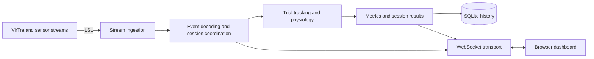

# LabReview

A real-time human performance monitoring dashboard built for VirTra-based simulation sessions. LabReview ingests physiological and behavioral data during live simulation sessions and displays running metrics on a local web.

---

## What it does

During a training scenario, LabReview connects to hardware streams over [Lab Streaming Layer (LSL)](https://labstreaminglayer.org/) — including physiological sensors (e.g., Polar H10, Pupil Labs Neon eye tracking) and VirTra simulator events, and routes them through a Python backend to a browser-based dashboard. When a VirTra scenario starts, the backend identifies which cognitive assessment is running, instantiates the appropriate trial tracker, and streams live trial-by-trial metrics to the frontend over WebSocket.

When the scenario stops, either from VirTra or the dashboard's Stop button, summary metrics are computed locally and shown in the after-action review (AAR) panel. Native sessions with valid trials are auto-saved; custom assessment rounds can be assigned to participants and saved individually.

## What you can do

- Watch connected streams and live performance as a simulation runs.
- Review trial outcomes and rolling physiological measures in one dashboard.
- Inspect a session summary after the scenario ends.
- Save results with participant information and revisit them in session history.

## How it works

1. The backend discovers available LSL streams from VirTra and connected sensors.
2. Incoming simulator events are decoded and matched to a configured scenario. The selected trial tracker and physiology services turn samples into structured observations.
3. Metric calculations update the live dashboard through a WebSocket connection. The browser displays results and sends operator actions; scoring stays in the backend.
4. At the end of a scenario, the backend produces an after-action summary and stores session or round results in a local SQLite database for later review.

## Architecture



| Area | Responsibility |
| --- | --- |
| `backend/lsl/` and `backend/event_decoders/` | Discover streams and turn native or custom samples into usable events. |
| `backend/services/` and `backend/scenarios/` | Manage the session lifecycle and select scenario behavior from configuration. |
| `backend/trial_models/`, `backend/physiology/`, and `backend/metrics/` | Track responses and sensor observations, then compute live and final measures. |
| `backend/transport/` and `backend/api/` | Send structured updates and handle dashboard commands over WebSocket. |
| `backend/services/database.py`, `backend/services/round_repository.py`, and `backend/audit/` | Persist results and event history locally. |
| `frontend/` | Serve the live view, after-action review, and session history as a static browser app. |

`backend/main.py` starts the backend services and serves the frontend. The frontend needs no separate build step.

## Run locally

You need Python 3.14 or newer and [`uv`](https://docs.astral.sh/uv/). Live monitoring also needs VirTra or other LSL-compatible streams available on the network.

From the repository root:

```bash
cd backend
uv run python main.py
```

The backend serves the dashboard at [http://localhost:3000](http://localhost:3000) and opens it in your browser by default. Its WebSocket server listens on port `8500`. You can open the dashboard manually if browser launch is disabled. Stop the process with Ctrl+C.

## Configuration and local data

- `backend/config.toml` sets the server ports, LSL polling behavior, database path, and browser launch option.
- `config/virtra_streams.toml` identifies native and custom VirTra streams and their shared event fields.
- `backend/scenarios/*/scenario.toml` and related scenario files define how recognized scenarios are tracked and scored.
- `database/labreview.db` is the default SQLite store for saved sessions, rounds, and event history.

The browser reads results from the backend; it does not calculate scores itself.
