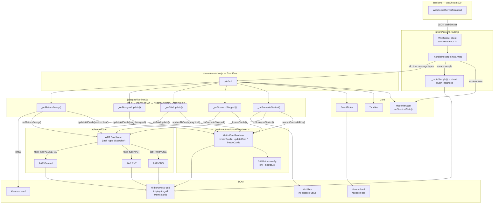

# LabReview Frontend — Architecture Reference

> **Last audited:** 2026-09-11  
> **Root:** `frontend/`  
> **Entry point:** `index.html` → `js/app.js` (ES module, deferred)  
> **Dev server:** `python3 -m http.server 3000`  
> **Backend WebSocket:** auto-detected as `ws://<page-host>:8500`

---

## 1. File Map — Every File and Its Role

### Root

| File | Role |
|------|------|
| [`index.html`](file:///Users/mikey/Desktop/Work/AFRL/DNLC/Projects/LabReview/frontend/index.html) | **Single HTML shell.** Defines the fixed layout (sidebar, topbar slot, main content, event bar footer). Loads all scripts in the correct order. No page content lives here — pages render themselves into `#page-*` containers. |

---

### `css/` — Design system

| File | Role |
|------|------|
| [`css/variables.css`](file:///Users/mikey/Desktop/Work/AFRL/DNLC/Projects/LabReview/frontend/css/variables.css) | **Design token master.** All CSS custom properties: colors, typography, spacing, layout dimensions, shadows, transitions. Everything else uses `var(--...)` tokens. |
| [`css/layout.css`](file:///Users/mikey/Desktop/Work/AFRL/DNLC/Projects/LabReview/frontend/css/layout.css) | **Global layout rules.** Sidebar, topbar, main content, event bar. Grid/flexbox structure. |
| [`css/pages.css`](file:///Users/mikey/Desktop/Work/AFRL/DNLC/Projects/LabReview/frontend/css/pages.css) | `.page` / `.page.active` show/hide mechanism. |
| [`css/pages/topbar.css`](file:///Users/mikey/Desktop/Work/AFRL/DNLC/Projects/LabReview/frontend/css/pages/topbar.css) | Connection status chip, transport controls, session picker, elapsed, meta chips. |
| [`css/pages/live-intel.css`](file:///Users/mikey/Desktop/Work/AFRL/DNLC/Projects/LabReview/frontend/css/pages/live-intel.css) | Session ribbon (LIVE dot, drill badge, elapsed, stop), metric card grids, results banner, save panel, sidebar stream list. |
| [`css/pages/replay.css`](file:///Users/mikey/Desktop/Work/AFRL/DNLC/Projects/LabReview/frontend/css/pages/replay.css) | Chart grid layout, idle overlay. Small file — replay chrome is mostly in topbar.css. |

---

### `js/shared/` — Stateless utilities (ES modules)

| File | Role |
|------|------|
| [`js/shared/constants.js`](file:///Users/mikey/Desktop/Work/AFRL/DNLC/Projects/LabReview/frontend/js/shared/constants.js) | **Single source of truth for URLs.** Exports `WS_URL` (auto-detects host), `ANALYSIS_API_BASE` (`http://127.0.0.1:8081`), `WS_RECONNECT_DELAY_MS`, `SIGNALS`, `DRILLS` array. Never hard-code URLs elsewhere. |
| [`js/shared/api.js`](file:///Users/mikey/Desktop/Work/AFRL/DNLC/Projects/LabReview/frontend/js/shared/api.js) | Pure utility functions: `analysisGet(path)`, `analysisPost(path, body)`, `wsSend(ws, obj)`. No state. |
| [`js/shared/format.js`](file:///Users/mikey/Desktop/Work/AFRL/DNLC/Projects/LabReview/frontend/js/shared/format.js) | Pure display helpers: `formatElapsed(s)` → `MM:SS`, `formatDelta(val)` → `+1.23 unit`, `formatDuration(s)` → `1m 30s`, `clamp()`, `truncate()`, `formatUnixTime()`. |
| [`js/shared/metric-card-renderer.js`](file:///Users/mikey/Desktop/Work/AFRL/DNLC/Projects/LabReview/frontend/js/shared/metric-card-renderer.js) | **Config-driven metric card builder.** Reads `LabReview.DrillMetrics` at runtime. `renderCards(behavioralEl, physioEl, drillKey)` builds the card grid. `updateCard(id, value)` flashes and updates one card. `updateAllCards(payload, source)` batch-updates from a `trial-update` or `biosignal-update` payload via dot-path field resolution. `freezeCards()` → RESULTS state. `clearCards()` → teardown. |

---

### `js/core/` — Infrastructure (loaded before pages)

| File | Role |
|------|------|
| [`js/core/plugin-registry.js`](file:///Users/mikey/Desktop/Work/AFRL/DNLC/Projects/LabReview/frontend/js/core/plugin-registry.js) | **Chart plugin registry.** `LabReview.registerPlugin({id, name, streamTypes[], create})`. `getPluginFor(streamType)`, `createChart(pluginId, container, meta)`. Used by Replay page to instantiate charts from the LSL stream catalog. |
| [`js/core/event-bus.js`](file:///Users/mikey/Desktop/Work/AFRL/DNLC/Projects/LabReview/frontend/js/core/event-bus.js) | **Lightweight pub/sub.** `EventBus.on(event, cb)`, `.off()`, `.emit(event, data)`. All cross-module communication goes through here. Nothing calls another module's function directly. |
| [`js/core/stream-router.js`](file:///Users/mikey/Desktop/Work/AFRL/DNLC/Projects/LabReview/frontend/js/core/stream-router.js) | **WebSocket transport + message dispatcher.** Owns the single `WebSocket`. Reconnects every 3 s. `_handleMessage(msg)` switches on `msg.type` and emits the corresponding EventBus event (see §6). Also routes `stream.sample` to chart plugin `pushSample()` instances. Exposes: `connect()`, `subscribe/unsubscribe/subscribeAll()`, `activateLive()`, `deactivateLive()`, `send(obj)`, `getCatalog()`, `ping()`. |
| [`js/core/mode-manager.js`](file:///Users/mikey/Desktop/Work/AFRL/DNLC/Projects/LabReview/frontend/js/core/mode-manager.js) | **Session state display layer.** Driven entirely by `session.state` messages. Runs a 60 fps RAF stopwatch for elapsed display (backend 1s ticks re-seed it). Manages legacy DOM elements with null-check guards. Emits `session-state-changed` and `position-updated`. |
| [`js/core/sidebar.js`](file:///Users/mikey/Desktop/Work/AFRL/DNLC/Projects/LabReview/frontend/js/core/sidebar.js) | **Page navigation.** `.nav-item[data-page]` click → show/hide `.page` containers → `TopBarManager.activate(page)` → emit `page-changed`. Manages event bar visibility. |
| [`js/core/timeline.js`](file:///Users/mikey/Desktop/Work/AFRL/DNLC/Projects/LabReview/frontend/js/core/timeline.js) | **Bottom timeline bar.** Progress rail, playhead, start/end labels, event marker dots. Replay: scrubbable (sends `seek` command). Live: advances with `position-updated`, not scrubbable. `addEventMarker(time, color, title)` places a timeline dot. |
| [`js/core/topbar-manager.js`](file:///Users/mikey/Desktop/Work/AFRL/DNLC/Projects/LabReview/frontend/js/core/topbar-manager.js) | **Per-page topbar slot.** Pages call `register(pageId, renderFn, teardownFn)`. `activate(pageId)` runs old page's teardown, clears `#topbar-slot`, calls new page's render function. |

---

### `js/plugins/` — Plugins

| File | Role |
|------|------|
| [`js/plugins/event-ticker.js`](file:///Users/mikey/Desktop/Work/AFRL/DNLC/Projects/LabReview/frontend/js/plugins/event-ticker.js) | **Event bar controller.** Populates `#event-feed` (VirTra events) and `#speech-box`. **Live mode:** appends rows from `EventBus.on('virtra-event')` and `'speech-update'`. **Replay mode:** parses CSV payload, uses binary search to highlight active event at current playback position. Suppresses noisy types (`Target Activated`, `Lane Targets Changed`, etc.). LSL timestamp → wall clock: `unix = lsl_ts + 978307200` (LSL epoch = Jan 1, 2001). |

---

### `js/features/aar/` — After Action Review

| File | Role |
|------|------|
| [`aar-dashboard.css`](file:///Users/mikey/Desktop/Work/AFRL/DNLC/Projects/LabReview/frontend/js/features/aar/aar-dashboard.css) | All `.aar-*` class definitions. Card flash animation, `--good`/`--alert`/`--warn` state colors, info tooltip button, alert rows. |
| [`aar-dashboard.js`](file:///Users/mikey/Desktop/Work/AFRL/DNLC/Projects/LabReview/frontend/js/features/aar/aar-dashboard.js) | **AAR dispatcher.** `TASK_TYPE_MODULES` maps `task_type` → module resolver. `onScenarioStarted(payload)` → `_activateModule(taskType)` → `module.mount(container)`. Forwards all lifecycle calls: `onEvent`, `onMetricsReady`, `onSensorUpdate`, `onScenarioStopped`, `onWeaponInfo`. `onTrialUpdate(msg)` dispatches to `onPvtUpdate` or `onGngUpdate` based on `msg.task_type`. |
| [`task-types/general.js`](file:///Users/mikey/Desktop/Work/AFRL/DNLC/Projects/LabReview/frontend/js/features/aar/task-types/general.js) | **General / catch-all module.** Renders: Session Context, Shooting Performance (shots/hits/misses/accuracy %), Live Event Breakdown table (sorted frequency), Live Event Stream feed (last 25 events). Live elapsed timer via `setInterval`. Merges official post-scenario metrics from Analysis on `onMetricsReady`. Renders unknown scalars as key-value list. |
| [`task-types/gng.js`](file:///Users/mikey/Desktop/Work/AFRL/DNLC/Projects/LabReview/frontend/js/features/aar/task-types/gng.js) | **GNG module.** Sections: Session Context (go/no-go counts, go proportion), Threat Engagement (hit/miss rate), Civilian Discrimination (false alarm/correct rejection rate), Response Timing (median/mean/SD RT). FA alert row. Live updates from `onGngUpdate` per trial; final values from `onMetricsReady`. |
| [`task-types/pvt.js`](file:///Users/mikey/Desktop/Work/AFRL/DNLC/Projects/LabReview/frontend/js/features/aar/task-types/pvt.js) | **PVT module.** Sections: Session Context (scenario, simulator, weapon, total trials, duration), Performance (median RT, mean RT, RT SD, omissions, hit/miss/omit %). Omission alert row. Live updates from `onPvtUpdate` per trial. Weapon from `onWeaponInfo`. |

---

### `js/config/` — Data-driven config

| File | Role |
|------|------|
| [`js/config/stream_catalog.js`](file:///c:/Users/DNLC/Desktop/Work/LabReview/frontend/js/config/stream_catalog.js) | **LSL stream display registry.** `LabReview.StreamCatalog` — array of descriptors mapping LSL streams to sidebar labels. Each entry has `namePattern` (regex on stream name), `typePattern` (optional regex on stream type), `label`, `icon`, and `display` (`false` = suppress from sidebar while still ingesting). **Edit only this file** to add, rename, or hide streams in the Connected Streams panel. Used by `live-intel.js` `_renderStreamList()`. |
| [`js/config/drill_metrics.js`](file:///c:/Users/DNLC/Desktop/Work/LabReview/frontend/js/config/drill_metrics.js) | **Metric card registry.** `LabReview.DrillMetrics` maps drill key → card definition array. `physiological` array holds the shared HR/HRV/pupil cards (shown for all drills). Card schema: `{id, label, unit, format, source, field, size, showWhen}`. `field` supports dot-notation (`hr.mean`). `format` values: `number`, `percent` (0–1 × 100), `ms`, `decimal`, `time`. **Edit only this file** to add/remove/change metric cards. |


---

### `js/pages/` — Page controllers

| File | Role |
|------|------|
| [`js/pages/live-intel.js`](file:///Users/mikey/Desktop/Work/AFRL/DNLC/Projects/LabReview/frontend/js/pages/live-intel.js) | **Live Human Performance controller.** Manages the 4-state machine (§5). Registers with `TopBarManager`. Builds page shell HTML dynamically. Delegates metric cards to `MetricCardRenderer`, charts to `AAR.Dashboard`. Renders Save Session Record panel in RESULTS state, sends `session.save_record` WebSocket message. |
| [`js/pages/replay-sessions.js`](file:///Users/mikey/Desktop/Work/AFRL/DNLC/Projects/LabReview/frontend/js/pages/replay-sessions.js) | **Replay page controller.** Session picker dropdown, transport controls, SessionInfo chips. Builds chart grid from LSL stream catalog using `StreamRegistry` + `ChartFactory` (future dependencies). Manages chart plugin instances (regular + fusion). |

---

### `js/drills/` — Legacy display stubs (not connected)

| File | Status |
|---|---|
| `js/drills/drill-display-base.js` | Documentation only — interface contract |
| `js/drills/general.js` | Has real logic but **not wired** into `LiveIntelPage` |
| `js/drills/pvt.js` | All methods are `// TODO` stubs |
| `js/drills/behavioral_discrimination.js` | All methods are `// TODO` stubs |
| `js/drills/inhibition_assessment.js` | All methods are `// TODO` stubs |
| `js/drills/marksmanship.js` | All methods are `// TODO` stubs |

---

### `js/app.js` — Bootstrap

| File | Role |
|------|------|
| [`js/app.js`](file:///Users/mikey/Desktop/Work/AFRL/DNLC/Projects/LabReview/frontend/js/app.js) | **ES module entry point.** Imports utilities and exposes them as `LabReview.Shared`. Initializes in order: `TopBarManager` → `Timeline` → `EventTicker` → `LiveIntelPage` → `ReplaySessionsPage` → `Sidebar` → event bar drag-resize → `StreamRouter.connect()`. Loaded last (`type="module"` defers automatically). |

---

## 2. Script Load Order

```
index.html loads in this exact order:

1.  js/core/plugin-registry.js          ← LabReview namespace + plugin registry
2.  js/core/event-bus.js                ← EventBus
3.  js/core/stream-router.js            ← WebSocket transport
4.  js/core/mode-manager.js             ← Session state display
5.  js/core/sidebar.js                  ← Navigation
6.  js/core/timeline.js                 ← Timeline bar
7.  js/core/topbar-manager.js           ← Topbar slot manager

8.  js/plugins/event-ticker.js          ← Event feed + speech panel

9.  js/features/aar/task-types/general.js  ─┐
10. js/features/aar/task-types/gng.js       │ AAR task-type modules
11. js/features/aar/task-types/pvt.js      ─┘
12. js/features/aar/aar-dashboard.js        ← AAR dispatcher (needs modules above)

13. js/config/stream_catalog.js             ← StreamCatalog registry (NEW)
14. js/config/drill_metrics.js              ← DrillMetrics registry
15. js/shared/metric-card-renderer.js       ← Card builder (reads DrillMetrics)

16. js/pages/live-intel.js                  ← LiveIntelPage (reads StreamCatalog)

17. js/app.js  (type="module", deferred)    ← Bootstrap: wires and starts everything
```

---

## 3. `LabReview` Global Namespace

```
LabReview
├── .EventBus               event-bus.js
├── .StreamRouter           stream-router.js
├── .ModeManager            mode-manager.js
├── .Sidebar                sidebar.js
├── .Timeline               timeline.js
├── .TopBarManager          topbar-manager.js
├── .EventTicker            event-ticker.js
├── .MetricCardRenderer     metric-card-renderer.js
├── .DrillMetrics           drill_metrics.js
├── .LiveIntelPage          live-intel.js
├── .ReplaySessionsPage     replay-sessions.js
├── .AAR
│   ├── .Dashboard          aar-dashboard.js  (dispatcher)
│   ├── .GNG                task-types/gng.js
│   ├── .PVT                task-types/pvt.js
│   └── .General            task-types/general.js
├── .Drills                 js/drills/ (legacy stubs, not wired)
├── .Shared                 WS_URL + format helpers (exposed by app.js)
├── ._plugins               plugin-registry.js internal store
├── .registerPlugin()
├── .getPluginFor()
└── .createChart()
```

---

## 4. Data Flow Diagram



---

## 5. LiveIntelPage State Machine

```
 IDLE
   │  → session.scenario_started (VirTra)   OR   → operator clicks ▶ Start
   ▼
 CAPTURING
   │  Live updates: trial-update → behavioral cards
   │                biosignal-update → physiological cards
   │  LIVE dot pulses, elapsed RAF ticks at 60 fps
   │  VirTra events → AAR.Dashboard.onEvent()
   │
   │  → session.scenario_stopped   OR   → operator clicks ■ Stop
   ▼
 SUMMARIZING
   │  Cards frozen (--frozen CSS class)
   │  Banner: "Scenario complete — computing final metrics…"
   │
   │  → session.metrics_ready (AnalysisServiceClient)
   ▼
 RESULTS
   │  Final metrics overwrite card values
   │  Save panel appears: Participant ID / Name / Notes
   │  → operator clicks "Save Record" → session.save_record WS message
   │  → session.record_saved → show success confirmation
   │  → operator clicks "↳ New Session"
   ▼
 IDLE  (full reset: cards cleared, drill state cleared, page shell rebuilt)
```

---

## 6. EventBus Event Reference

### Emitted by `StreamRouter` (originated from backend WebSocket messages)

| EventBus event | Backend message type | Key payload fields |
|---|---|---|
| `ws-connected` | connection open | — |
| `ws-disconnected` | connection close | — |
| `catalog-updated` | `streams.catalog` | `stream[]` |
| `session-state-changed` | `session.state` | `{state, elapsed_seconds, duration_seconds, mode}` |
| `scenario-started` | `session.scenario_started` | `{drill_key, drill_label, task_type, scenario_name}` |
| `scenario-stopped` | `session.scenario_stopped` | `{drill_key}` |
| `virtra-event` | `session.virtra_event` | `{event_type, description, metadata, timestamp}` |
| `biosignal-update` | `session.biosignal_update` | `{hr, hrv, pupil, is_final}` |
| `trial-update` | `session.trial_update` | `{task_type, trial, running_metrics}` |
| `metrics-ready` | `session.metrics_ready` | full metrics dict |
| `speech-update` | `session.speech_update` | `{text, timestamp}` |
| `weapon-info` | `session.weapon_info` | `{weapon_type}` |
| `record-saved` | `session.record_saved` | `{success, path}` |
| `api-error` | `api.error` | `{code, message, context}` |
| `stream-sample-received` | `stream.sample` | `{streamId, timestamp, data, elapsed}` |
| `session-info-received` | `stream.sample` (SessionInfo stream) | `{participant_id, session_name, drill}` |

### Emitted by other modules

| EventBus event | Emitter | When |
|---|---|---|
| `page-changed` | Sidebar | User clicks nav item |
| `position-updated` | ModeManager | Every `session.state` with `duration_seconds > 0` |

---

## 7. How to Add a New AAR Task-Type Module

### Step 1 — Create `js/features/aar/task-types/<name>.js`

```js
window.LabReview = window.LabReview || {};
window.LabReview.AAR = window.LabReview.AAR || {};

LabReview.AAR.MyType = (function () {
  let _container = null;

  function mount(el)                   { _container = el; _renderWaiting(); }
  function unmount()                   { _container = null; }
  function reset()                     { _renderWaiting(); }
  function onScenarioStarted(payload)  { /* build live panel */ }
  function onMetricsReady(metrics)     { /* populate final cards */ }
  function onSensorUpdate(_)           { /* no-op — MetricCardRenderer handles physio */ }
  function onScenarioStopped(_)        { /* show export row */ }
  function onWeaponInfo(payload)       { /* optional: update weapon card */ }

  function _renderWaiting() {
    if (!_container) return;
    _container.innerHTML = `
      <div class="aar-panel">
        <div class="aar-waiting">
          <div class="aar-waiting-label">My Drill Type</div>
          <div class="aar-waiting-sub">Waiting for VirTra scenario to start…</div>
        </div>
      </div>`;
  }

  return { mount, unmount, reset,
           onScenarioStarted, onMetricsReady, onSensorUpdate,
           onScenarioStopped, onWeaponInfo };
})();
```

### Step 2 — Register in `aar-dashboard.js`

In [`js/features/aar/aar-dashboard.js`](file:///Users/mikey/Desktop/Work/AFRL/DNLC/Projects/LabReview/frontend/js/features/aar/aar-dashboard.js):

```js
const TASK_TYPE_MODULES = {
  'GNG':     () => LabReview.AAR.GNG,
  'PVT':     () => LabReview.AAR.PVT,
  'GENERAL': () => LabReview.AAR.General,
  'MYTYPE':  () => LabReview.AAR.MyType,  // ← add here
};
```

### Step 3 — Add the `<script>` tag in `index.html`

```html
<script src="js/features/aar/task-types/mytype.js"></script>  <!-- before aar-dashboard.js -->
<script src="js/features/aar/aar-dashboard.js"></script>
```

**Done.** The backend `task_type` in `session.scenario_started` controls which module activates.

---

## 8. How to Add a Metric Card to an Existing Drill

Edit **only** [`js/config/drill_metrics.js`](file:///Users/mikey/Desktop/Work/AFRL/DNLC/Projects/LabReview/frontend/js/config/drill_metrics.js):

```js
pvt: [
  // ... existing cards ...
  {
    id:     'my_metric',           // unique; DOM id = mc-my_metric
    label:  'My Metric',
    unit:   'ms',
    format: 'ms',                  // 'number' | 'percent' | 'ms' | 'decimal' | 'time'
    source: 'trial',               // 'trial' | 'biosignal'
    field:  'running_metrics.my_field',  // dot-path into backend payload
    size:   'md',                  // 'lg' | 'md' | 'sm'
  },
],
```

`MetricCardRenderer.updateAllCards(payload, 'trial')` picks it up automatically.

---

## 9. Design System Quick Reference

### Key colors (`css/variables.css`)

| Token | Value | Used for |
|---|---|---|
| `--bg-sidebar` | `#1B2A4A` | Dark navy sidebar |
| `--accent-blue` | `#3D6ECC` | Primary actions, Shot Fired |
| `--accent-green` | `#2D8E54` | Shot Hit, good metrics |
| `--accent-red` | `#C94444` | Miss, error metrics, LIVE dot |
| `--accent-orange` | `#C47A2A` | Unscored Hit, warn metrics |
| `--accent-purple` | `#6B5DB8` | Scenario Started events |
| `--text-muted` | `#7B8499` | Secondary labels, idle states |

### Layout dimensions

| Token | Value |
|---|---|
| `--sidebar-width` | `230px` |
| `--topbar-height` | `52px` |
| `--timeline-height` | `150px` |
| `--panel-radius` | `8px` |

### Transitions

| Token | Value | Use |
|---|---|---|
| `--transition-fast` | `120ms ease` | Hover effects |
| `--transition-normal` | `200ms ease` | Card flash, modal |
| `--transition-slow` | `350ms ease` | Page transitions |

---

## 10. Cleaned Up Dead Code / Issues

The following dead code and obsolete files were removed:

| Item | Action Taken |
|---|---|
| `js/drills/` folder (6 files) | **Deleted**: Legacy stubs (`drill-display-base.js`, `general.js`, `pvt.js`, `behavioral_discrimination.js`, `inhibition_assessment.js`, `marksmanship.js`) replaced by `js/features/aar/task-types/`. |
| `js/pages/replay-sessions.js` & `css/pages/replay.css` | **Deleted**: Broken replay controller referencing missing dependencies (`StreamRegistry` and `ChartFactory`). |
| `css/pages.css` | **Deleted**: Unused CSS index file. |
| `js/shared/api.js` | **Deleted**: Obsolete HTTP client for the removed Analysis FastAPI (`:8081`). |
| `ANALYSIS_API_BASE` (`constants.js`) | **Removed**: Removed the dead constant from `shared/constants.js`. |
| `ModeManager` (in `mode-manager.js`) | **Pruned**: Removed 9 dead DOM element queries (`#btn-mode-live`, `#btn-play-pause`, etc.) and legacy helpers. Now a clean session state listener and event emitter. |

---

## 11. Current Directory Structure

```
frontend/
├── index.html                         ← Single page shell
├── frontend_architecture.md           ← Architecture & system reference
│
├── css/
│   ├── variables.css                  ← Design token master (colors, spacing, fonts)
│   ├── layout.css                     ← App structure
│   └── pages/
│       ├── topbar.css                 ← Top bar chrome
│       └── live-intel.css             ← Live page (ribbon, cards, save panel)
│
└── js/
    ├── app.js                         ← Bootstrap (ES module, loads last)
    │
    ├── shared/
    │   ├── constants.js               ← WS_URL, DRILLS
    │   ├── format.js                  ← Display formatters
    │   └── metric-card-renderer.js    ← Card builder + updater
    │
    ├── core/
    │   ├── plugin-registry.js         ← Chart plugin registry
    │   ├── event-bus.js               ← Pub/sub bus
    │   ├── stream-router.js           ← WebSocket + message dispatch
    │   ├── mode-manager.js            ← Session state tracker & event emitter
    │   ├── sidebar.js                 ← Page navigation
    │   ├── timeline.js                ← Bottom timeline bar
    │   └── topbar-manager.js          ← Per-page topbar slot
    │
    ├── plugins/
    │   └── event-ticker.js            ← Event feed + speech panel
    │
    ├── features/
    │   └── aar/
    │       ├── aar-dashboard.css      ← AAR card + panel styles
    │       ├── aar-dashboard.js       ← Dispatcher (task_type → module)
    │       └── task-types/
    │           ├── general.js         ← General / Marksmanship display
    │           ├── gng.js             ← Go/No-Go display
    │           └── pvt.js             ← PVT display
    │
    ├── config/
    │   └── drill_metrics.js           ← Metric card definitions
    │
    └── pages/
        └── live-intel.js              ← Live page controller (4-state machine)
```
